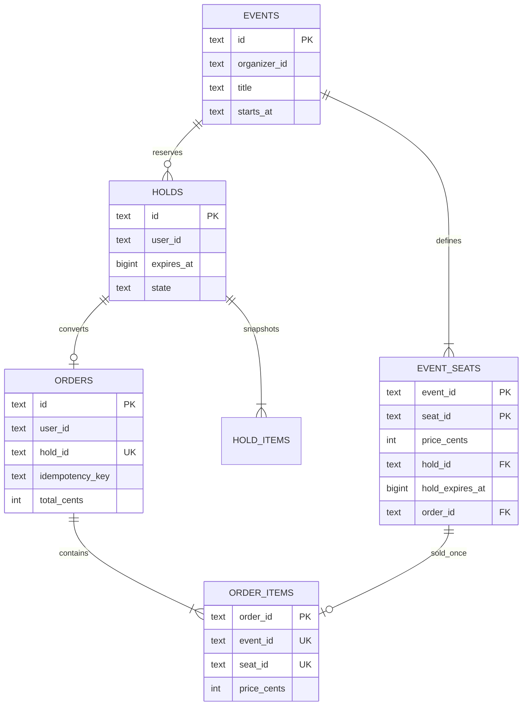

# Architecture and design decisions

## Product scope

SeatSage demonstrates a primary ticket marketplace. Fans discover and purchase tickets; organizers publish experiences and monitor sales. Venues and performers are catalog context rather than independent authenticated tenants in this MVP.

The end-to-end flow is real up to payment: catalog queries, durable inventory changes, ownership checks, confirmation records, and dashboards use the backend. Payment authorization is simulated and tickets are visibly marked as demo artifacts.

## Service ownership

| Component | Responsibility | Why it exists |
| --- | --- | --- |
| React / TypeScript | Discovery, filters, favorites, seat map, checkout, tickets, organizer UI | Responsive presentation, no authority over prices or inventory |
| Nginx | SPA delivery, same-origin `/api` proxy | One browser origin and no public inventory endpoint |
| FastAPI `/api/v1` | Session, validation, catalog, search orchestration, order reads, organizer views | OpenAPI contract and Python application layer |
| Go inventory | Hold acquisition/release and final booking transactions | A small, independently testable concurrency boundary |
| PostgreSQL | Events, seats, durable holds, immutable orders/items | Transactional authority and uniqueness constraints |
| Redis | `hold:{uuid} → user_id`, with a TTL matching the durable deadline | Expiring cache markers; useful for presence/hold lookup integrations |
| Elasticsearch | Event text index with weighted title/venue search and fuzzy matching | Discovery across descriptive catalog text |

The Go service and FastAPI share a schema in this demo. FastAPI writes catalog/initial seat definitions, while only Go changes distributed reservation and purchase state. In a larger system, inventory would own its own database and receive catalog changes through events.

Checkout receipts include event metadata without recalculating venue-wide availability. The API caches up to 256 immutable event descriptions for receipt enrichment. Availability and prices used for booking are always checked separately; a future event-editing endpoint must invalidate the metadata cache.

Redis is deliberately **not a distributed mutex** here. A Redis lock plus a PostgreSQL transaction cannot be committed atomically. Making PostgreSQL authoritative avoids overselling after cache loss, failover, a stale key, or a crash between database commit and cache update. Redis markers have no bearing on whether an order may commit. This is a safer and more accurate explanation than “Redis alone prevents double-booking.”

## Relational model



The order-item uniqueness constraint is on the **pair** `(event_id, seat_id)`. The order idempotency constraint is on `(user_id, idempotency_key)`.

Seat status is derived:

- **Sold:** `order_id IS NOT NULL`.
- **Held:** unsold, with a hold reference whose deadline is in the future.
- **Available:** unsold and no live hold.

Expiration does not require a cleanup job. Old references can remain until reuse because every read and acquisition checks the deadline. The `holds.state` column records `active`, `released`, or `consumed`; an active row can be temporally expired.

All monetary amounts are integer cents. Seat prices are set by the catalog, copied into hold items, and made immutable in order items. No price-editing API exists in this demo. A production price-editing feature would also need checkout to use the hold-item price snapshot explicitly.

## Reservation sequence

```mermaid
sequenceDiagram
    participant Fan as Browser
    participant API as FastAPI
    participant Go as Go inventory
    participant PG as PostgreSQL
    participant R as Redis
    Fan->>API: POST /api/v1/holds (event, seat IDs)
    API->>API: Validate signed session and input
    API->>Go: Authenticated internal request + trusted user ID
    Go->>PG: BEGIN; SELECT seats ORDER BY seat_id FOR UPDATE
    Go->>PG: Check every seat is unsold and not live-held
    alt A selected seat is unavailable
        Go->>PG: ROLLBACK
        Go-->>Fan: 409 conflict, no partial reservation
    else All seats available
        Go->>PG: Insert hold and hold_items; set seat hold deadline
        Go->>PG: COMMIT
        Go->>R: SET hold:{id} user EX remaining TTL (best effort)
        Go-->>Fan: Hold ID, deadline, subtotal, server time
    end
```

Holding a group is all-or-nothing. Locks are acquired in a deterministic seat-ID order. Different events or non-overlapping groups can progress independently in PostgreSQL.

The UI polls availability every four seconds and refreshes after a conflict. Selecting a seat is only a local interaction; **Reserve my seats** is the point at which ownership is requested. Prices and availability shown before that request are informational.

## Checkout and retries

1. The browser creates an idempotency key once per successful hold. Network retries retain that key.
2. Go begins a transaction and takes a transaction-scoped PostgreSQL advisory lock derived from `(user_id, key)`. This serializes simultaneous retries of one checkout.
3. If an order already exists for the key, return that exact order. Reusing the key with a different hold returns `409`.
4. Lock the owned hold row, then lock all relevant seat rows in sorted order.
5. Recheck state, deadline, hold ownership, and sold status **after acquiring locks**, using PostgreSQL's clock for the deadline decision.
6. Calculate the disclosed 8% fee using integer rounding. Insert the order and its seat items, mark seats sold, and consume the hold in one transaction.
7. Commit, then remove the Redis key best-effort. Return the durable receipt.

A request that commits but loses its HTTP response can be retried safely. A new key on a consumed hold does not create a second order. The unique seat-item constraint is a second line of defense beyond locking.

Payment is intentionally absent. Real payment processing requires an explicit pending-payment order state, a provider idempotency key, signed webhooks, and a transactional outbox/compensation strategy. Never hold database row locks while waiting for a payment provider.

## Failure behavior

| Failure | Observable result |
| --- | --- |
| Two people request overlapping seats | One wins the overlapping seats; the other receives `409`; no partial group |
| Hold reaches its deadline | Seats become eligible for acquisition; expired checkout fails |
| Old holder releases after someone else reserves | Release only updates rows still referencing the old hold ID |
| Redis is unavailable or a key is evicted | Database checks still enforce the reservation; cache operation is bounded and logged |
| API or inventory process dies after commit | Same checkout key retrieves the existing durable order |
| Elasticsearch is unavailable | Catalog search falls back to SQL substring matching |
| Go service is unavailable | Booking requests return `503`; browsing can still work |
| Database is unavailable | No booking is accepted; health/readiness fails |
| Browser is closed mid-hold | No purchase occurs; the durable deadline allows reuse |

The demo has no background index-repair worker. An unsuccessful indexing attempt marks search as unavailable until API restart or the next organizer publish rebuilds the index. SQL remains authoritative throughout.

## API surface

| Method | Endpoint | Access / purpose |
| --- | --- | --- |
| GET | `/api/v1/health` | Mode and catalog database readiness |
| GET | `/api/v1/session` | Current signed demo session |
| POST | `/api/v1/demo/session` | Start/switch attendee or organizer demo |
| GET | `/api/v1/events?q=&category=&city=&sort=` | Public discovery |
| GET | `/api/v1/events/{id}` | Public event details |
| GET | `/api/v1/events/{id}/seats` | Session required; availability |
| POST | `/api/v1/holds` | Session required; 1–6 distinct seats |
| DELETE | `/api/v1/holds/{id}` | Hold owner only |
| POST | `/api/v1/checkout` | Hold owner; `Idempotency-Key` required |
| GET | `/api/v1/orders` | Only the current session’s tickets |
| GET | `/api/v1/organizer/dashboard` | Organizer demo role |
| POST | `/api/v1/organizer/events` | Organizer demo role |

FastAPI generates the full schemas in `/docs`. Every response includes an API request ID. Unsafe browser requests with an untrusted Origin are rejected. Cookies are signed, HttpOnly, SameSite=Lax, and Secure when configured for HTTPS.

The internal Go API requires a shared service token and is not exposed by Compose. User IDs come from the verified FastAPI session, never from a browser-supplied identity header.

## Scaling and production evolution

The source demonstrates the critical booking invariant, not a finished production marketplace. For an internet-facing service:

1. Replace demo role switching with OIDC/Cognito authentication and organizer tenant authorization.
2. Move schema changes and seeds into a single migration job; remove startup schema ownership from API replicas.
3. Run API and inventory as separate autoscaled ECS services with private service discovery. Size connection pools against the database connection budget.
4. Use managed PostgreSQL with Multi-AZ, backups, monitoring, and point-in-time recovery.
5. Use a durable Elasticsearch service or Elastic Cloud, and update the index through an outbox and worker rather than synchronous full rebuilds.
6. Add payment/webhook state transitions, refunds, admission validation, email delivery, and audit trails.
7. Add rate limits, request budgets, abuse controls, structured tracing, queue-time metrics, and alarms for lock waits and database saturation.
8. Partition very hot inventory workloads by event if measured contention justifies it. Consider a waiting room for flash-sale traffic.

Load tests must distinguish virtual users from simultaneous in-flight checkouts. Report successful checkout count, expected conflicts, unexpected error rate, latency percentiles, hardware, and invariant-audit results together.
